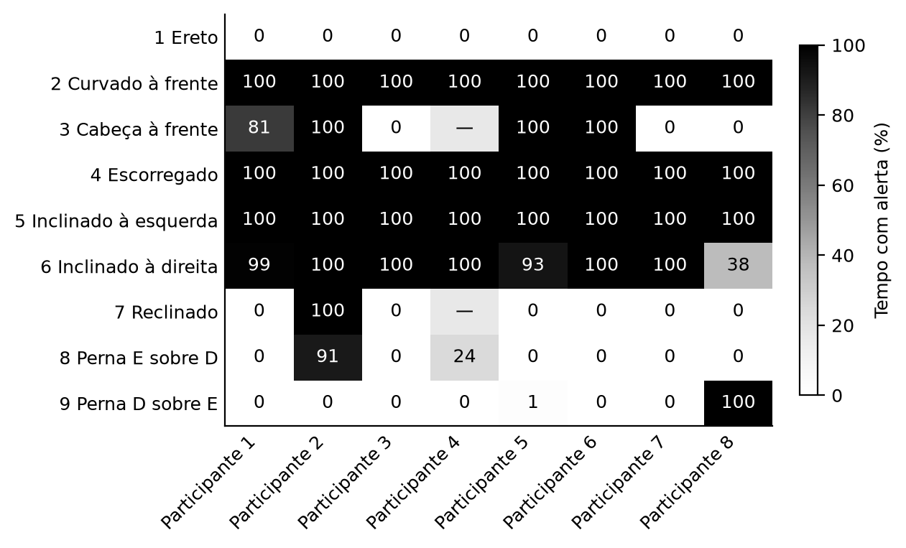
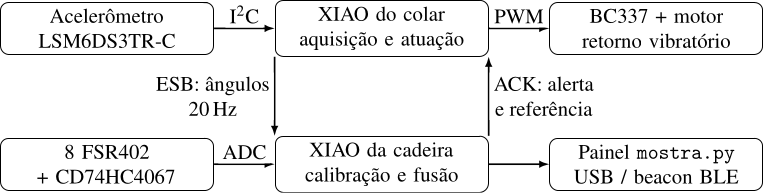
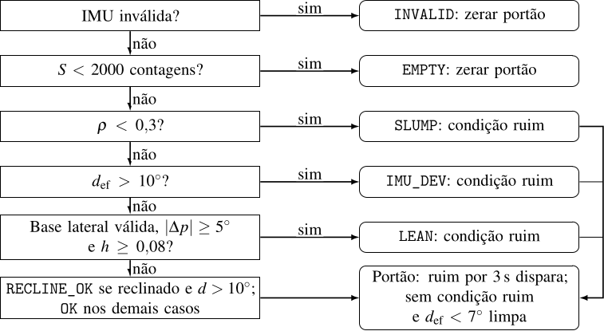
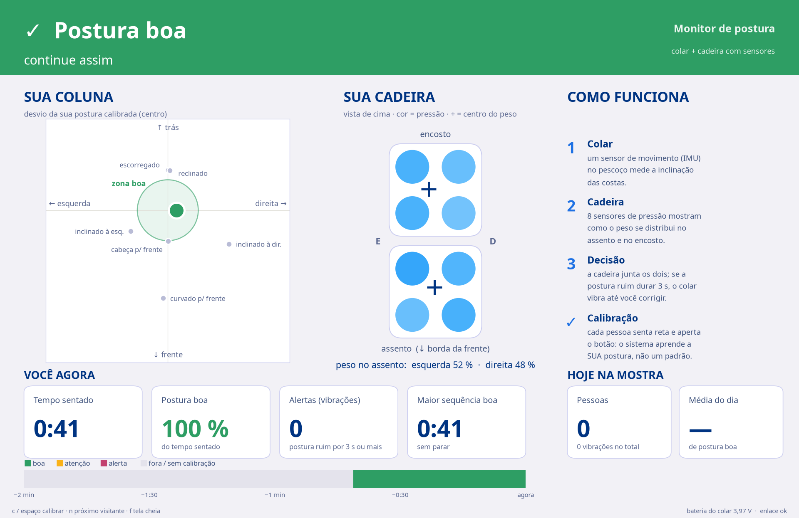

# Posture Monitoring System

An embedded system that detects harmful sitting posture in office workers and
alerts them in real time with a vibration, so they correct themselves.

It fuses two sources of information:

- **How body weight is distributed on the chair**: 8 force-sensing resistors
  (FSR402) in the seat and backrest.
- **The orientation of the upper back**: an IMU in a collar worn just below
  the neck.

Each user calibrates the system to their own upright posture with a button
press. The chair combines both sources, and if a harmful posture lasts 3 s, the
collar vibrates until the user corrects it. It runs on its own, with no
computer, app or cloud. A Python dashboard is optional and only displays the
state.

Undergraduate final project (TCC), Control and Automation Engineering, Instituto
Mauá de Tecnologia (IMT), 2026, by André Thomas Monteiro, Felipe Fernandes
Rojas Godoi and Vinicius Carnicelli Beleti, advised by Profa. Me. Andressa
Corrente Martins. Original title: *Sistemas Inteligentes Aplicados à
Ergonomia no Ambiente de Trabalho*.

<p align="center">
  
  
  
</p>

## Results

Replay tests used 9 sessions with **8 participants** holding 9 instructed
postures (123 segments, ~51 min). *Final fusion* has parameters tuned on all
the data. *LOSO* (leave-one-subject-out) scores each person with parameters
tuned on the other seven:

| Indicator | IMU only | Final fusion | Fusion, LOSO |
|---|:-:|:-:|:-:|
| Harmful-posture segments detected | 55/62 | 58/62 | **58/62 (94 %)** |
| Harmful-posture time with alert | 84 % | 93 % | 92 % |
| Upright/reclined time with alert (false alarms) | 29 % | 2 % | **3 %** |
| Crossed-legs time with alert | 10 % | 11 % | 28 % |

Most of the gain comes from fusion. The seat sensors stop false alarms when
the user reclines with the hips supported, and they catch the hips sliding
forward, which the IMU alone can't tell apart from reclining. At the Eureka
science fair, more than 150 visitors used the system with individual
calibration and vibration feedback. Harmful posture was detected in almost
every case observed (qualitative, not recorded as data). A 600 mAh cell ran
the collar for both days (~20 h) without running out.

The main limitation is head-forward posture on its own: the head moves but the
upper back barely does. Full discussion: [report](report/) (PT-BR).

<p align="center">
  <br>
  <sub>Alert time (%) per participant and posture with the final fusion rule. Rows 2–6 should alert, the others should not.</sub>
</p>

## How it works

<p align="center">
  
</p>

- **Collar (body unit)**: Seeed XIAO nRF52840 Sense. It reads the onboard
  LSM6DS3TR-C accelerometer over I²C, computes pitch/roll and sends them at
  20 Hz. A BC337 transistor drives a coin vibration motor by PWM. Powered by a
  1S LiPo with low-battery cutoff.
- **Chair (the "brain")**: a second XIAO nRF52840 Sense reads the 8 FSR402s
  (4 seat + 4 backrest) through a CD74HC4067 multiplexer into one
  3.3 kΩ divider. It captures the calibration, runs the fusion rule and sends
  the alert back to the collar.
- **Link**: Nordic Enhanced ShockBurst (ESB, `nrf_to_nrf`). The collar
  transmits, and the chair's decision rides back in the ACK payload. If no ACK
  arrives for 1 s, the collar falls back to an IMU-only rule.
- **Dashboard** (`analysis/mostra.py`): reads the chair over USB or its
  one-way BLE beacon. For display only.

### Fusion rule

The chair checks a fixed list of conditions against the calibrated reference.
A **bad condition** is the seat's rear unloaded (slid forward), IMU deviation
over 10°, or a lean confirmed by the seat's left/right load. A bad condition
held for **3 s** triggers the alert. The alert clears once there is no bad
condition and the deviation is below 7°. Supported reclining, crossed legs
and an empty seat don't alert. Rationale (PT-BR):
[`docs/decisao-fusao-imu-fsr.md`](docs/decisao-fusao-imu-fsr.md).

<p align="center">
  
</p>

Circuit schematics (PDF):
[collar](report/imt/figures/met-esquema-colar.pdf) ·
[chair](report/imt/figures/met-esquema-cadeira.pdf) ·
[collar firmware flow](report/imt/figures/met-fluxo-colar.pdf).

### Dashboard

<p align="center">
  
</p>

## Repository layout

| Path | Contents |
|---|---|
| [`firmware/`](firmware/README.md) | Arduino sketches (`chair/`, `body/`), the shared `PostureLink` library (protocol and alert rules), host tests, toolchain and flashing |
| [`analysis/`](analysis/README.md) | Python tools: dashboard (`mostra.py`), live view and capture logger (`live_posture.py`), fusion replay and leave-one-subject-out tuning, report figures |
| [`data/`](data/README.md) | Raw CSV captures and the run registry |
| [`docs/`](docs/) | Capture protocol, design decisions, usage guides (PT-BR) |
| [`report/`](report/) | LaTeX report: the IMT delivery version (`report/imt/`) and the long version (`report/relatorio_final.tex`) (PT-BR) |

## Quick start

```bash
# Firmware (arduino-cli, Seeed nRF52 core). See firmware/README.md for board selection
arduino-cli compile --fqbn Seeeduino:nrf52:xiaonRF52840Sense --libraries firmware/libraries firmware/chair
arduino-cli compile --fqbn Seeeduino:nrf52:xiaonRF52840Sense --libraries firmware/libraries firmware/body
make -C firmware/test            # host unit tests, no board needed

# Analysis / dashboard
python3 -m venv .venv
.venv/bin/pip install -r analysis/requirements.txt
.venv/bin/python analysis/mostra.py           # USB/BLE auto-select
```

Usage: sit upright at the back of the seat and press the chair's button to
calibrate. The LED turns green when the calibration is captured.
