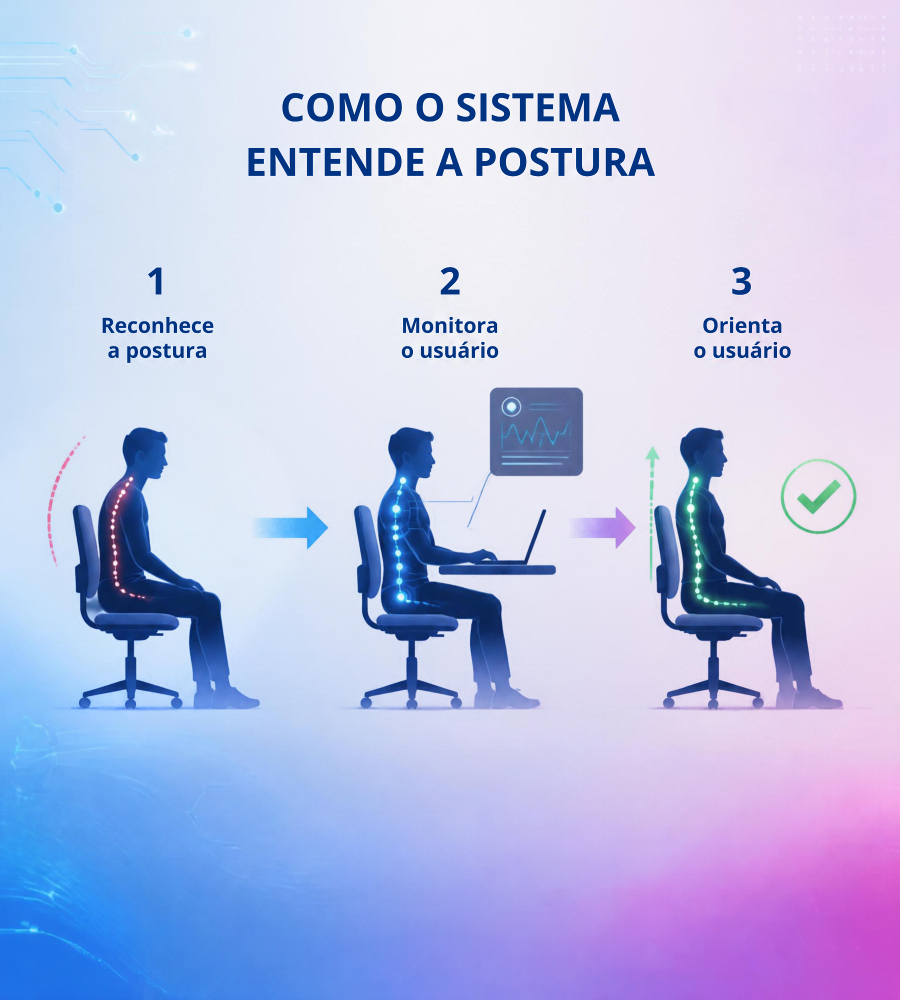

# Design do stand — mostra de ciência

Guia visual para tudo que vai no stand (painéis, tela do `mostra.py`,
etiquetas, folheto). A referência são os dois painéis já impressos; qualquer
peça nova deve parecer parte deles.

| `painel-como-funciona.png` | `painel-silhuetas.png` |
|---|---|
|  |  |

## Linguagem visual

- **Silhueta, não foto:** pessoas e cadeira em azul-marinho chapado, de perfil,
  sem rosto detalhado. A pessoa boa está sempre **reta, sentada até o fundo,
  com as costas no encosto**.
- **A coluna é o personagem:** uma linha pontilhada que brilha (glow) ao longo
  das costas, com a cor do estado: vermelho = ruim, azul = monitorando,
  verde = boa.
- **Gradiente azul → violeta → magenta** nas bordas e em ondas suaves que
  sobem da base; o centro fica claro (lavanda/branco) para o conteúdo.
- **Leitura da esquerda para a direita:** ruim → monitora → corrige, com setas
  em gradiente entre os passos.
- **Detalhes "tech" discretos:** linhas de circuito finas e pontos de luz nos
  cantos, em azul-claro com baixa opacidade. Nunca atrás de texto.
- **Muito respiro:** pouco texto, títulos grandes, nada de borda dura nem
  sombra forte.

## Paleta

Amostrada dos painéis (valores aproximados, impressão pode variar).

| token | hex | uso |
|---|---|---|
| `navy` | `#003482` | títulos, números, texto principal |
| `silhueta` | `#092f6f` | silhuetas de pessoa e cadeira |
| `azul-royal` | `#1440bb` | onda escura da base, silhueta da pessoa boa (`#081a97` no mais escuro) |
| `azul-vivo` | `#1e71e4` | canto inferior esquerdo do gradiente |
| `ciano` | `#32a8fb` | seta 1, coluna "monitorando", circuitos |
| `violeta` | `#9142d4` | meio do gradiente, silhueta reclinada |
| `lilás` | `#ba85ed` | seta 2, transições |
| `magenta` | `#cd4fd3` | canto inferior direito do gradiente |
| `rosa` | `#e962d0` | destaque (silhueta curvada) |
| `fundo` | `#f2f1f6` | fundo claro (vai para `#fcfcfc` / `#cccef0`) |

Cores de estado (as da coluna):

| estado | hex | onde |
|---|---|---|
| ruim | `#f16ca2` (glow) | coluna vermelha, arco tracejado |
| monitorando | `#28b3f4` | coluna azul |
| boa | `#4bc384` | coluna verde, ✓ no círculo |

**Gradientes:**
- base: `linear-gradient(to right, #1e71e4, #9142d4, #cd4fd3)`;
- setas: `#32a8fb → #3aa5f2` (azul) e `#ba85ed → #e962d0` (lilás → rosa).

Regra: estado sempre com **ícone + texto**, não só cor (daltonismo; mesmo
princípio do `docs/guia-mostra.md`).

## Tipografia

- Sans-serif geométrica **bold**, cantos levemente arredondados: títulos em
  caixa-alta (no painel: "COMO O SISTEMA ENTENDE A POSTURA"), subtítulos em
  caixa normal. Fontes próximas e gratuitas: **Nunito** (subtítulos) e
  **Open Sans ExtraBold** / **Montserrat Bold** (títulos).
- Texto sempre em `navy` sobre fundo claro, ou branco sobre o gradiente
  escuro. Sem texto sobre a região magenta/lilás clara (contraste baixo).
- Hierarquia: título (caixa-alta) → número do passo → verbo curto
  ("Reconhece", "Monitora", "Orienta") → no máximo uma frase.

## Peças e como aplicar

- **Painéis impressos:** os dois acima (prontos).
- **Tela do `mostra.py`:** hoje usa as cores do `live_posture` (fundo
  `#fcfcfb`, verde `#0ca30c`, âmbar `#fab219`, vermelho `#d03b3b`, azul
  `#2a78d6`). Proposta para alinhar com o stand (não aplicada):
  - texto/títulos em `navy`;
  - números dos passos em `ciano`;
  - faixa de topo com o gradiente da base;
  - verde → `#4bc384`; vermelho → `#f16ca2` ou um tom mais escuro para
    contraste com texto branco.
  - **Âmbar ("Atenção") não existe nos painéis**; manter âmbar ou usar
    `lilás`? Fica a decidir.
- **Etiquetas na cadeira/colar, folheto, crachá:** fundo `fundo`, título em
  `navy`, faixa fina com o gradiente na base, um ícone de coluna na cor do
  estado.
